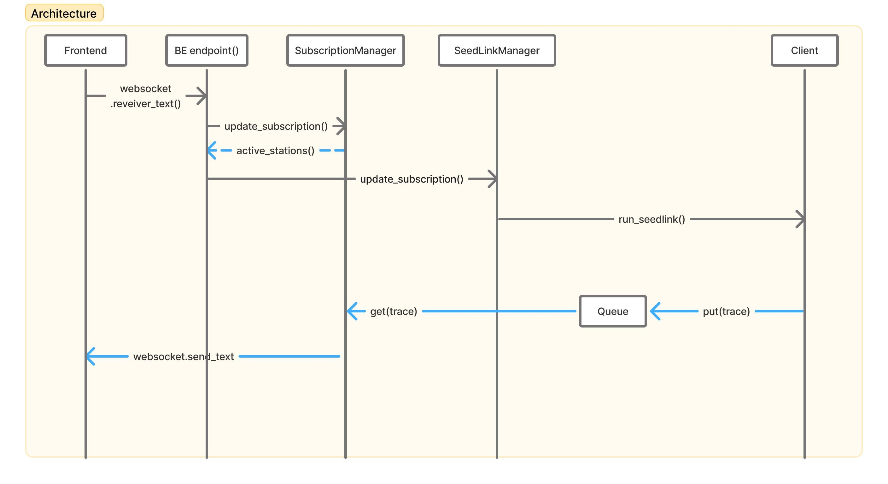

## 架構圖

* Client：連到 SeedLink server
* Quere： trace 序列，讓接收資料和推送資料可以分開處理
* SeedLinkManager ：管後端實際要連哪些 SeedLink streams，沒訂閱的就不連
* SubscriptionManager：管每個 websocket 訂閱哪些 stations
* BE endpoint() ：後端 WebSocket API 接入點，負責接收前端連線與訂閱訊息。

* loop：Client thread 把 trace 交給非同步處理流程的傳話筒，Client thread 收到 trace 後，透過 loop 放進 Queue
